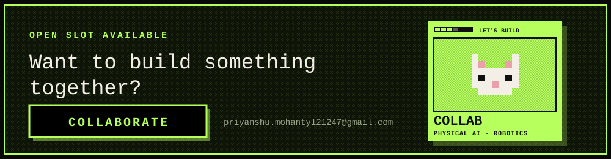

<div align="center">



<a href="mailto:priyanshu.mohanty121247@gmail.com"></a>
<a href="https://www.linkedin.com/in/YOUR_LINKEDIN/"></a>
<a href="https://github.com/YOUR_USERNAME"></a>

</div>

<br/>

## 👾 ABOUT_ME.EXE

```
$ whoami
priyanshu_mohanty

$ cat about.txt
status    : exploring a lot. can you even blame me?!!!
role      : final-year B.Tech IT @ VSSUT, Burla
intern    : Software Intern @ SIMHATEL
focus     : Physical AI · Agentic AI · Robotics
learning  : DSA · AWS
goal      : MLOps / Robotics Automation / AI Engineer
also      : Deputy Secretary-General, VSSUT MUN 2026
            Graphics Design Lead, VSSUT Literary Society
wins      : national-level hackathon, with Chakravyuh (multimodal RAG)
```

<br/>

## 🕹️ TECH_STACK.EXE

<div align="center">



</div>

<details>
<summary><b>Show the full stack list</b></summary>

<br/>

**Languages**
<br/>


**Web**
<br/>


**AI / Data**
<br/>


**Robotics / Embedded**
<br/>


**Cloud / Tools**
<br/>


</details>

<br/>

## 💾 PROJECTS.EXE

| Project | What it is |
| :-- | :-- |
| **Chakravyuh** | Multimodal RAG system, national-level hackathon winner |
| **Flight Log Analyzer** | Drone flight log analysis service with automated failure diagnosis |
| **Terrain Pipeline** | GPS-to-3D terrain reconstruction pipeline for drones |
| **Chronos** | C++ timetable generator that ingests a class schedule |

<br/>

## 🐍 SNAKE.EXE

<div align="center">


</div>

<br/>

## 🐟 KOI.EXE

<div align="center">


</div>

<br/>

## 📟 STATS.EXE

<div align="center">


</div>

<br/>

## 🐾 COLLAB.EXE

<div align="center">

<a href="mailto:priyanshu.mohanty121247@gmail.com?subject=Let%27s%20collaborate">
  
</a>

</div>

```
$ echo "see you in the next commit"
```
